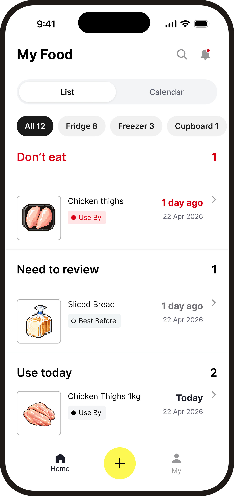
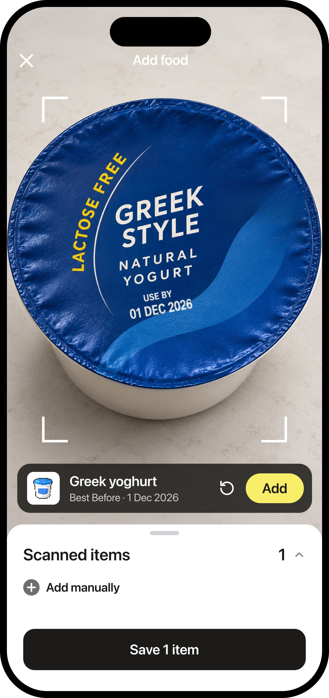
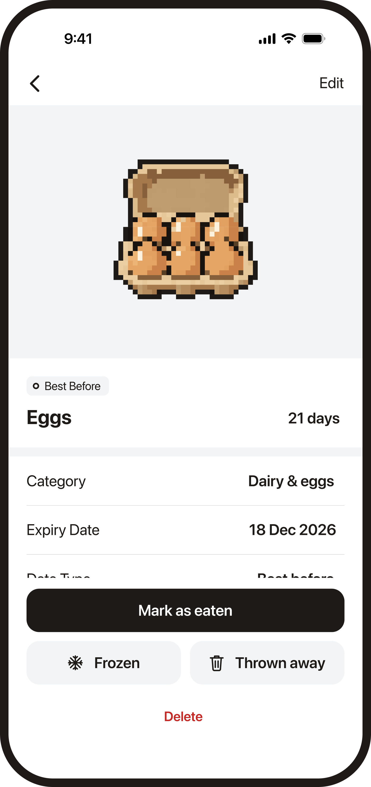

# Piggy Fridge

Piggy Fridge helps UK households use food before it goes off. Scan a label, and the app tracks the date for you, with clear reminders that treat **Use By** and **Best Before** differently.

<!-- Add 3–4 screenshots here: Home, Scan, Food detail, My Food calendar -->

  
  
  

## What it does

- **Scan instead of typing.** The camera reads the food name and expiry date from the label text.
- **Manual entry when scanning fails.** If the camera can't read the name or date, adding it by hand is one tap away.
- **Use By vs Best Before.** The two date types lead to different actions, so the app shows them differently.
- **No sign-up.** There's no account or login, and your data stays on your phone.

## Built with

- SwiftUI (iOS)
- Xcode
- Figma for design
- Claude as an AI coding partner

## My role

I co-founded Piggy Fridge with a partner, and the two of us designed and built it together.

- Co-designed the app and its visual identity, from colour palette and typography to every screen in Figma
- Built the foundation of every screen in SwiftUI, from layout structure to core components
- Ran usability testing with 5 people on the first build and made 2 changes, including making the manual entry button easier to find

## How I used AI

I used Claude to help write and debug SwiftUI code. I review what it produces, test every change on my own phone, and fix what doesn't work. Building it this way meant I could test a design decision in the running app the same day instead of waiting on a handoff.

## Status

Submitted to the App Store. <!-- Update to "Available on the App Store" with a link once it's live -->

## Case study

Read the full design story at [nationaljiopark.com/piggy-fridge](https://nationaljiopark.com/piggy-fridge).
